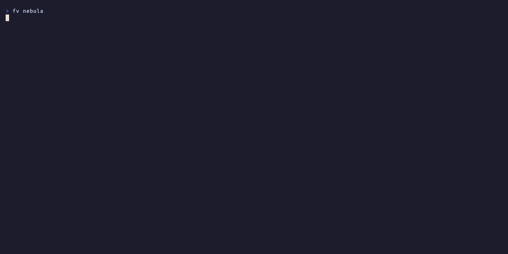
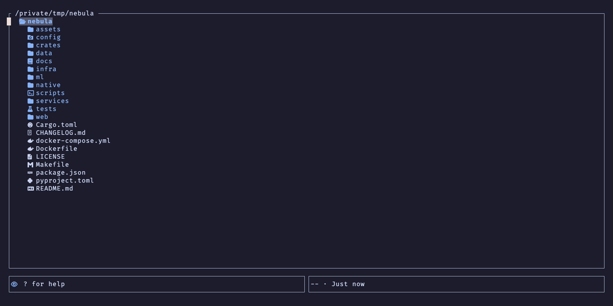

# FileView Keybindings

Complete keybinding reference for FileView (fv).

## Navigation

| Key | Action |
|-----|--------|
| `j` / `↓` | Move down |
| `k` / `↑` | Move up |
| `g` | Go to top |
| `G` | Go to bottom |

## Tree Operations

| Key | Action |
|-----|--------|
| `l` | Expand directory |
| `h` / `Backspace` | Collapse directory |
| `→` | Expand directory (or switch focus to preview when visible) |
| `←` | Collapse directory (or switch focus to tree when visible) |
| `Enter` | Expand or collapse a directory, open a file in fullscreen preview, or close the side preview when it is open |
| `H` | Collapse all |
| `L` | Expand the visible directories one more level, down to depth 5 |

## Selection

| Key | Action |
|-----|--------|
| `Space` | Toggle mark |
| `V` | Start visual selection mode |
| `*` | Select all items |
| `Alt+I` | Invert selection |
| `Esc` | Clear all marks |

## File Operations

| Key | Action |
|-----|--------|
| `a` | Create new file |
| `A` | Create new directory |
| `r` | Rename |
| `R` | Bulk rename (when files are selected) |
| `D` / `Delete` | Delete (with confirmation) |
| `y` | Copy to clipboard |
| `d` | Cut to clipboard |
| `p` | Paste |

## Search

| Key | Action |
|-----|--------|
| `/` | Start search |
| `Enter` | Jump to the next match after the cursor and return to browsing |
| `Esc` | Cancel search |
| `n` | Next search result |
| `N` | Previous search result |
| `Ctrl+P` | Open fuzzy finder |

Match count is displayed in status bar (e.g., `3/12 matches`). The query stays
active after Enter, so `n` and `N` keep moving between matches.

## Sorting

| Key | Action |
|-----|--------|
| `S` | Cycle sort mode: Name → Size → Date → Name |

- **Name**: Alphabetical order (case-insensitive)
- **Size**: Largest files first
- **Date**: Newest files first
- Directories are always sorted first within each mode
- Current sort mode is shown in status bar when not default

### Fuzzy Finder

Press `Ctrl+P` to open the built-in fuzzy finder:

| Key | Action |
|-----|--------|
| `↑` / `Ctrl+K` | Move up in results |
| `↓` / `Ctrl+J` | Move down in results |
| `Enter` | Jump to selected file |
| `Esc` / `Ctrl+P` | Cancel |

- Type to filter files by name. Workspace search also accepts `ext:rs`,
  `type:file`, `type:dir`, and `git:changed` filters.
- Workspace search runs in the background and respects local ignore files.
  Stdin selection searches only the supplied paths.
- The same search is available from the CLI with `fv search 'ext:rs' .`.
  See [the workspace experiment](WORKSPACE_ENGINE.md) for current limits.
- Start a query with `text:` to search literal, case-sensitive file contents
  using ripgrep (`rg`), for example `text:TODO`. Enter opens the matching line.
  This applies to workspace browsing, not stdin selection. Selecting a workspace
  result clears the tree filter so the target can be focused correctly.
- Filename results are sorted by match score; content results follow scan order.
- Hidden files follow the current visibility setting

## Preview

| Key | Action |
|-----|--------|
| `P` | Toggle side preview panel |
| `o` | Open fullscreen preview |
| `Tab` | Switch focus between tree and preview when the side preview is open, otherwise the same as `Enter` |
| `←` / `→` | Collapse / expand (switch focus when preview visible) |
| `[` | Previous PDF page |
| `]` | Next PDF page |
| `PageUp` / `PageDown` | Page through the preview when it has focus |

SVG files are shown as images, without any text they contain. Markdown files
are shown rendered when the preview pane is at least 80 columns wide, such as in
fullscreen preview. Narrower panes show the raw source. Files
with an extension FileView does not know are previewed as text when their
content is UTF-8 text, and as a hex dump otherwise.

### Side Preview Focus Mode

When the side preview panel is open:

| Focus | j/k/↑/↓ | g/G | b/f |
|-------|---------|-----|-----|
| Tree | Navigate files | Top/Bottom of list | - |
| Preview | Scroll content | Top/Bottom of preview | Page scroll |

- Click on a panel to switch focus
- The scroll wheel scrolls the panel under the pointer
- `Esc` returns focus to tree (when preview is focused)
- Focused panel has cyan border highlight

### PDF Preview

PDF files are rendered as images using `pdftoppm` from poppler-utils:

| Key | Action |
|-----|--------|
| `[` | Go to previous page |
| `]` | Go to next page |

- Requires `pdftoppm` (poppler-utils) to be installed
- Current page and total pages shown in title bar: `document.pdf (3/10)`
- Falls back to hex preview if poppler-utils is not installed

## Clipboard

| Key | Action |
|-----|--------|
| `c` | Copy path to system clipboard |
| `C` | Copy filename to system clipboard |
| `Y` | Copy file content to clipboard |

## Git Operations

| Key | Action |
|-----|--------|
| `s` | Stage file |
| `u` | Unstage file |
| `Ctrl+G` | Select all git-changed files |
| `Alt+G` | Select git-staged files only |
| `Ctrl+Shift+T` | Select test file pair |
| `Alt+R` | Select files from recent commit |

## AI / Claude Code

| Key | Action |
|-----|--------|
| `Ctrl+Y` | Copy in Claude-friendly format |
| `Ctrl+Shift+Y` | Copy AI context pack |
| `Ctrl+Shift+Enter` | Copy review context pack |
| `Alt+Y` | Copy in compact format |
| `Ctrl+A` | Toggle AI focus mode |
| `Alt+A` | Toggle AI follow-mode (auto-focus on the AI's most recent file) |
| `Alt+L` | Open the live AI activity log popup |
| `Ctrl+Shift+P` | Open AI history |
| `Alt+P` | Toggle peek mode (mini preview in status bar) |
| `Ctrl+R` | Select related files |
| `Ctrl+E` | Select error context files |
| `Ctrl+1`-`Ctrl+9` | Select by extension (1:rs, 2:ts/tsx, 3:js/jsx, 4:py, 5:go, 6:java/kt, 7:md/mdx, 8:json/yaml/toml, 9:css/scss/sass) |
| `Alt+M` | Cycle the model used for the token budget |

FileView reads keys in the traditional terminal encoding, which cannot tell
`Ctrl+Shift` apart from `Ctrl`. In practice `Ctrl+Shift+T` acts as `Ctrl+T`,
`Ctrl+Shift+Y` as `Ctrl+Y`, `Ctrl+Shift+P` as `Ctrl+P`, and `Ctrl+Shift+Enter` as
`Enter`. `Ctrl` with a digit is not delivered reliably either. Many terminals send
`Ctrl+3` as `Esc` and `Ctrl+8` as `Backspace`.

## Tabs

| Key | Action |
|-----|--------|
| `Ctrl+T` | New tab |
| `Ctrl+W` | Close tab |
| `Alt+t` | Next tab |
| `Alt+T` (`Alt+Shift+t`) | Previous tab |

## Bookmarks

Press `m` followed by a digit (1-9) to set a bookmark, and `'` followed by a digit to jump:

| Key | Action |
|-----|--------|
| `m1`-`m9` | Set bookmark at slot 1-9 |
| `'1`-`'9` | Jump to bookmark at slot 1-9 |
| `m` / `'` | Cancel (press again without digit) |

- Bookmarks persist for the current session only
- A status message shows the bookmarked path when set
- Jumping to an unset bookmark shows "Bookmark N not set"

## File Filter

Press `F` to set or clear a file filter:

| Key | Action |
|-----|--------|
| `F` | Open filter input / clear filter |
| `Enter` | Apply filter |
| `Esc` | Cancel |

- Supports glob patterns: `*` (any chars), `?` (single char)
- Examples: `*.rs`, `test*`, `*_test.py`
- Directories are always shown for navigation
- Active filter is shown in status bar with filter icon
- Press `F` again when filter is active to clear it

## Other

| Key | Action |
|-----|--------|
| `.` | Toggle hidden files |
| `F5` | Refresh |
| `\` | Open the TODO and FIXME list for the workspace |
| `?` | Show help |
| `q` | Quit |
| `Esc` | Quit, after it has cleared marks and returned focus to the tree |
| `Q` | Quit and cd to current directory (with `--choosedir`) |

## Mouse Support

| Action | Effect |
|--------|--------|
| Click | Select item |
| Double-click | Expand or collapse a directory |
| Scroll | Navigate the list or scroll the preview, whichever is under the pointer |
| Drop | Copy files dropped from another app into the focused directory, or into the folder of the focused file |

Set `mouse_enabled = false` in `config.toml` to turn mouse capture off.

Text previews load at most 64KiB or 256 lines per window. Existing scroll, page,
`g`, and `G` controls continue across windows. `G` scans line counts in the
background; `g` can cancel it. Windows opened in the middle of a file display plain
text first, then receive background syntax colors. Expensive syntax reconstruction
falls back to readable plain text with a reason in the title.
